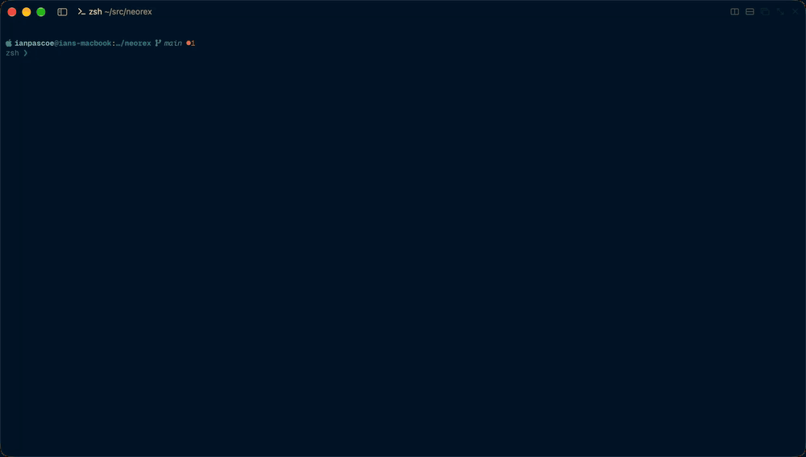

# neorex

A Rex-Native Neovim frontend built in Rust.

One Neovim runs in the background behind all your panes, so buffers,
registers, undo and language servers are shared. `:split` and `:vsplit` open
real Rex panes where Neovim would put the window, and closing a pane in Rex
closes its window. Focusable floats, such as pickers, open in Rex floating
panes, along with any floats attached to them. The completion menu,
unfocusable floats like notifications, and statuslines are drawn inside the
pane they belong to.



## Status

Very early and rough: expect bugs and missing features.

neorex has been built with heavy use of AI, first in Zig and now in Rust.
Much of the code still needs cleanup and better design, which is happening
incrementally. Contributions are welcome.

## Requirements

- macOS, or Linux: it builds and passes its tests there, but hasn't been tried live yet (#43)
- [Rex](https://www.superlogical.com/rex)
- A recent Neovim, 0.12 or later.
- Rust (stable, 2024 edition) to build
- Zig 0.17, only for the golden tests: they build Ghostty

## Build and run

With [just](https://github.com/casey/just) (`just` lists the recipes):

```sh
just build
just test
just golden   # also the golden tests; downloads and builds Ghostty once
```

or with Cargo alone:

```sh
cargo build
cargo test
scripts/golden.sh --test golden
```

The golden tests check every frame neorex draws against
[Ghostty](https://github.com/ghostty-org/ghostty)'s terminal emulator, pinned
to one commit. They're behind the `golden` feature, so a plain build never
builds Ghostty.

To install it, optimized, as `~/.local/bin/neorex`, with `nrex` linked to
it as a shorthand:

```sh
just install
just prefix=/usr/local install
```

It replaces the binary rather than writing over it, which on macOS gets a
new build killed at launch.

Run it in a Rex pane, with any Neovim arguments:

```sh
target/debug/neorex some/file.txt
```

Neovim starts with `g:neorex` set, before your config loads, so the config
can tell it's running under neorex:

```lua
{ 'sphamba/smear-cursor.nvim', cond = vim.g.neorex == nil },
```

The tabline shows across the panes along the top of the Rex window. When
another pane, such as a shell, takes part of the top, those panes are narrower
than Neovim's screen, and neorex fits the tabline to them: every `'tabline'`
that isn't empty ends at the right edge of the tabline panes (a fitted
tabline), so the `%=`-aligned right end of one such as lualine's shows. A
tabline too wide for them is cut as Neovim would cut it on a screen that wide.
While a `%!` `'tabline'` is drawn, `vim.o.columns` reads as the tabline
width, so a tabline whose Lua lays out to it, such as bufferline's, fits its
own widths too. Widths a tabline computes from `'columns'` any other way don't
fit by themselves, such as lualine's `max_length` or a Vimscript `&columns`;
they can read `g:neorex_tabline_width`, set to the tabline width while it's
narrower than the screen:

```lua
local width = vim.g.neorex_tabline_width or vim.o.columns

-- lualine's tabs and buffers components
require('lualine').setup({
  tabline = {
    lualine_a = {
      { 'buffers', max_length = function() return vim.g.neorex_tabline_width or vim.o.columns end },
    },
  },
})
```

```vim
let width = get(g:, 'neorex_tabline_width', &columns)
```

While `'tabline'` is empty, neorex draws the built-in tabline itself: a copy
of Neovim 0.12's, laid out to the tabline panes, whose labels count and name
each tab page's own windows
([ADR 0002](docs/adr/0002-neorex-draws-the-built-in-tabline-itself.md)).
Set `'tabline'` to anything else and that shows instead; set it back to empty,
or put back a saved copy of neorex's value, and the built-in tabline comes
back. neorex's copy differs from the built-in tabline Neovim draws in a few
ways:

- `:set tabline?` shows neorex's value rather than nothing.
- Labels are drawn in the highlight groups `NeorexTabLineSel` and
  `NeorexTabLine`, which neorex keeps set from `TabLineSel` and `TabLine`.
- A label window's `'winhighlight'` is ignored.
- A color that `TabLineSel` or `TabLine` leaves unset, and `Normal` does too,
  comes from `TabLineFill`.
- A wide character the close button cuts in half is drawn blank.

`neorex help debug` lists the debug commands, which run each layer on its
own: keys, Neovim's redraw events, the renderer, and pane hand-off.

## How it runs

Running `neorex` in a Rex pane starts a daemon in the background, which runs
one headless Neovim and gives each of its windows a Rex pane. The pane you ran
it in becomes the first window's. It takes its bearings from the environment
Rex sets in every pane:

- `REX_SERVER`: the URL of the Rex server to connect to. Required.
- `REX_SESSION`: the Rex session to open panes in. Required.
- `REX_BLOCK`: the id of the pane `neorex` was run in. Optional: the daemon
  uses it as the first window's pane, and logs a note if it isn't a block id.
- `NEOREX_LOG`: how much the daemon logs, read as it starts. `warn`: what
  went wrong; `info`, the default: that, and what happened; `debug`: that,
  and the trace timestamps `docs/latency.md` reads. Any other value logs a
  warning, and `info` is used.
- `NEOREX_TMPDIR`: where daemons keep their files, instead of `/tmp`. A
  relative path is taken from the directory `neorex` runs in.

Each window's Rex pane runs `neorex attach --address <the daemon's address>
--pane <pane id>`, which hands its terminal to the daemon (ADR 0013,
`docs/attach-protocol.md`) and waits until the daemon ends the attach; Rex then
closes the pane. The pane id, such as `2-k3j9x2qpa8`, is good for that one
pane's terminal only. A terminal left over from an older daemon, which ran
`neorex pane`, exits with `neorex: pane was replaced by attach --pane (this
came from an older daemon)`.

If stdin isn't a terminal, `neorex` prints `neorex: stdin isn't a terminal;
to start a daemon without one, use --detach` and exits 1. In a terminal but
without `REX_SERVER` or `REX_SESSION`, it prints `neorex: run it in a Rex
pane` and exits 1. The `debug-rex` command reads the same three variables.

Each daemon has a name: the name of the directory `neorex` was started in,
cut to its letters, digits, `.`, `_` and `-`, and to 32 characters (`default`
if nothing is left), with `-2`, `-3`, … added while a daemon of that name
runs. `--name N` names it exactly N instead. A daemon keeps its files (its own
socket `sock`, Neovim's `nvim.sock`, and its `log`) in
`$NEOREX_TMPDIR/neorex-<uid>/<daemon name>/`, `/tmp` standing in for an unset
`NEOREX_TMPDIR` (ADR 0004). The directory `neorex-<uid>` must be yours, a real
directory, and mode 0700, or `neorex` refuses to start and names
`NEOREX_TMPDIR`. The daemon holds a lock on its own directory while it runs,
which is how it's known to be running. Its log stays after it ends, however it
ends; the next daemon of that name keeps it as `log.1`, replacing an older
one. `neorex --help` says the same.

To try a build without it grabbing the focus in your own Rex session, which
neorex does as it works, make a session of your own with `rex new`, and run it
there, or in a terminal started with `REX_SESSION` set to that session's id
(`REX_SERVER` stays as Rex set it). A terminal started from one of your own
panes inherits that pane's `REX_BLOCK`, which the daemon would use as the first
window's pane, in your session: unset `REX_BLOCK`, or set it to a block in the
new session.

## Command reference

`neorex --help` (also `-h`, `help`, or `-h` after any command) prints:

```text
neorex: one Neovim in the background, shown in every terminal attached to it.

Usage:
  neorex [OPTIONS] [NVIM-ARGS...]
  neorex attach [--name N | --address A] [--provider P] [+LINE] [FILE]
  neorex list [--json]
  neorex status [--name N | --address A] [--json]
  neorex kill [--name N | --address A | --all] [--force]
  neorex provider check [--config FILE] [--provider P] [--daemon-name N]
                        [--no-find] [--full] [--json]
  neorex provider show [NAME]
  neorex provider types [--config FILE]
  …
```

Not built yet: `attach` (but for the hidden `attach --pane` of a Rex pane),
`list`, `status`, `kill`, `provider`, and the `--address`, `--detach` and
`--no-wait` options exit 1 with `neorex: list isn't built yet`. `--provider`
is accepted and does nothing. `--name N` starts a daemon named N, but while N
runs it exits 1 with `neorex: N is already running` instead of attaching.

### Own options first, then Neovim's

`neorex` reads its own options only from the front of the command line
([ADR 0014](docs/adr/0014-own-options-come-first-and-command-words-never-name-files.md)).
Long ones take ` VALUE` or `=VALUE`, and none can be abbreviated. The first
word that isn't one of them, and every word after it, goes to Neovim as
typed, a `--` included: `neorex -- --name` opens a file named `--name`. One of
`neorex`'s options after Neovim's have begun is a usage error saying where it
goes.

Only the first argument can be a command word (`attach`, `list`, `status`,
`kill`, `provider`, `help`, `version`), and it runs the command even when a
file of that name exists, with a note on stderr; `neorex ./list` opens the
file. `detach` is held for a later command.

### Version

`neorex -v` (also `--version`, `version`) prints the build, then the
protocols it speaks:

```text
neorex 0.0.0 (a1b2c3d, 2026-11-09)
attach protocol 1
pane provider protocols 1
```

### Refused Neovim arguments

These can't work under a daemon, so `neorex` refuses them, saying why, and
starts nothing:

| Word | Why |
|---|---|
| `--embed`, `--headless`, `--listen…` | the daemon starts Neovim with them itself |
| `--server…`, `--remote…` | they talk to another Neovim |
| `--help`, `--version`, `--api-info`, `-h`, `-?`, `-v` after other arguments | Neovim would print and exit |
| `-l`, `-es`, `-Es` | they run Neovim without a screen |
| `-V`, or `-V2` and up, without a file | Neovim wouldn't start |
| `-` | the daemon's Neovim can't read stdin |
| `-r` or `-L` with no file | it only lists swap files |

Anything else Neovim itself rejects fails the start.

### Output and exit statuses

What was asked for (help, version) goes to stdout; everything else goes to
stderr as one `neorex: …` line. A usage error is one line ending
`(see neorex --help)`. A reader that closes the pipe early ends `neorex`
quietly.

| Status | Meaning |
|---|---|
| 0 | success |
| 1 | a failure or refusal |
| 2 | a usage error, or a refused Neovim argument |

## Troubleshooting

- "run it in a Rex pane": `REX_SERVER` or `REX_SESSION` is missing. Start
  `neorex` from a Rex pane, or set both (see above) to a session you made.
- "the daemon didn't start; see <path>", or a failure line in the pane: read
  the log at that path.
- A daemon's log is `/tmp/neorex-<uid>/<daemon name>/log` (under
  `$NEOREX_TMPDIR` if set), and the one before it `log.1`.
- While it runs, Neovim's own messages go to the same log, since the
  daemon's stderr is Neovim's.

## Current limitations

- The `<C-w>` resize, swap and move commands do nothing. Use Rex's own pane
  controls instead. The exception is resizing a window in a tab page's
  floating pane, below: that resizes its Rex pane.
- `<C-w>h/j/k/l` (also `<C-w><C-h>`, `<C-w><BS>` and `<C-w><Left>` and the like,
  in Normal and Visual mode) move to the neighbouring pane in Rex, and stay
  put at an edge. A count repeats the move, up to 20 times. Mappings that
  remap them work, such as LazyVim's `<C-h>`; a `noremap` mapping to `<C-w>h`
  (kickstart.nvim's) skips them, and so do `:wincmd h` and `vim.cmd.wincmd`
  from a plugin: those step through the panes like `<C-w>w`. The move happens
  after the keys typed with it: `<C-w>lZZ` in a mapping or macro runs `ZZ` in
  the old window.
  - Rex servers whose `session.focus_direction` has no `wrap` option wrap
    around at an edge. Ones without the method do nothing for these keys,
    and log the refusal.
  - Rex looks at every pane in its window, so a move can enter an open
    floating pane, such as a tab page's, and leave it.
- Plugins that arrange windows (sidebars, layout managers) don't get the
  placement they expect, except in a tab page's floating pane, below. A
  window such a plugin moves back into Neovim's own layout goes back to its
  pane. edgy.nvim works without turning it off:
  neorex tells it to leave the windows in panes alone (`vim.w.edgy_disable`),
  so its edges don't dock anything. A plugin that keeps moving a window back
  as fast as neorex puts it in its pane (5 times in 2 seconds, with nothing
  typed and no pane resized) wins for a while: that window stays in Neovim's
  layout, its pane stays blank, and you still type into it. neorex tries
  again after 2 seconds, then 4, up to a minute. Turn such a plugin off with
  `cond = vim.g.neorex == nil`.
- Neovim tab pages aren't Rex tabs. A tab page opened after startup, as
  `:tabnew`, Neogit and Diffview open, shows in a Rex floating pane and
  closes with its last window. Its windows' panes are placed as Neovim's
  layout has them, at about their sizes, so Diffview's file panel is on the
  left. They follow the layout as windows come and go, and a window Neovim
  resizes, such as with `<C-w>|`, resizes its pane. Moving windows once they
  show in panes, as with `<C-w>H`, still does nothing.
- Neovim's current tab page doesn't follow focus. It stays put when you focus
  the pane of another tab page's window, and changes only when something
  changes it in Neovim, such as `:tabnext`, a click on the tabline, or a tab
  page closing. So `tabpagenr()`, the tabline's highlighted label, `:tcd` and
  `t:` variables belong to the current tab page, not to the focused window's
  home tab page.
- Neovim's tab-page queries don't match neorex's tab pages (#67). Every
  window shown in a pane sits in Neovim's current tab page, so
  `tabpagebuflist()`, `tabpagewinnr()` and `nvim_tabpage_list_wins()` see all
  of them in the current tab page, along with a hidden window neorex keeps in
  each tab page, and see the other tab pages as holding only that hidden
  window. Plugins that label tab pages from them, such as lualine's `tabs`
  component, show the wrong labels. The built-in tabline, while `'tabline'`
  is empty, shows the right ones: neorex draws it from its own record of each
  window's home tab page.
- Plugins that draw cursor effects with editor floats, such as
  smear-cursor.nvim, draw them in the wrong place: Neovim can't tell them
  where a pane's window is.
- No external command line or messages: long messages still show
  "Press ENTER".
- No global statusline: neorex treats `laststatus=3` as `2`, so each pane
  shows a statusline, the current window's: with lualine's
  `globalstatus = true`, the same line in every pane. Set `globalstatus`
  explicitly: lualine skips neorex's windows without it, and its default,
  `vim.go.laststatus == 3`, is false once neorex has turned `laststatus=3`
  into `2`.
  A pane's own `setlocal statusline` is replaced by that line meanwhile, and
  comes back when the pane takes focus, or when `laststatus` is set to
  another value.

## Plans

Much of neorex will be split out into standalone crates:

- a Neovim RPC client (msgpack, message framing, requests)
- a Rex API client (WebSocket and the control protocol)
- terminal key input (the kitty keyboard protocol)

neorex should then be easier to extend to other editors that provide similar processes for running external windows.

## Credits

neorex was created by [Alex Locke](https://github.com/alexrlocke), in Zig, at
[alexrlocke/neorex](https://github.com/alexrlocke/neorex). This repository
started as a fork of it and continues it independently, rewritten in Rust.
The commit history from the original is kept.

## License

MIT, as the original. See [LICENSE](LICENSE).
